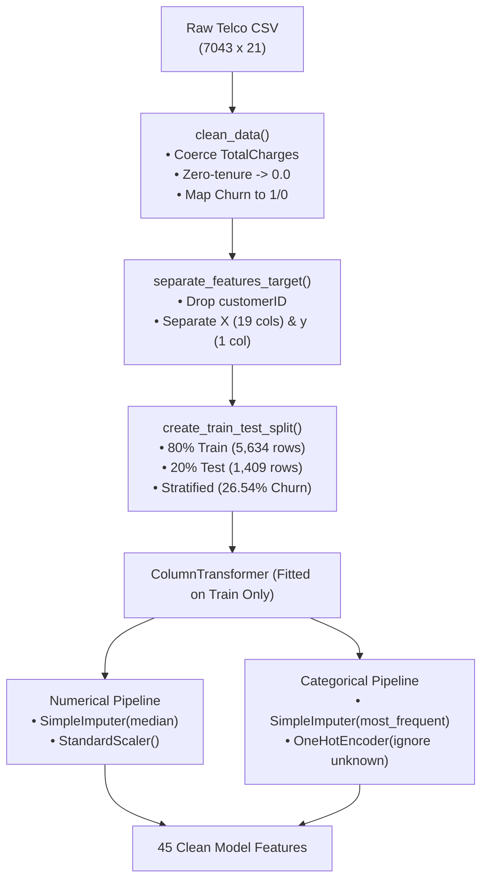
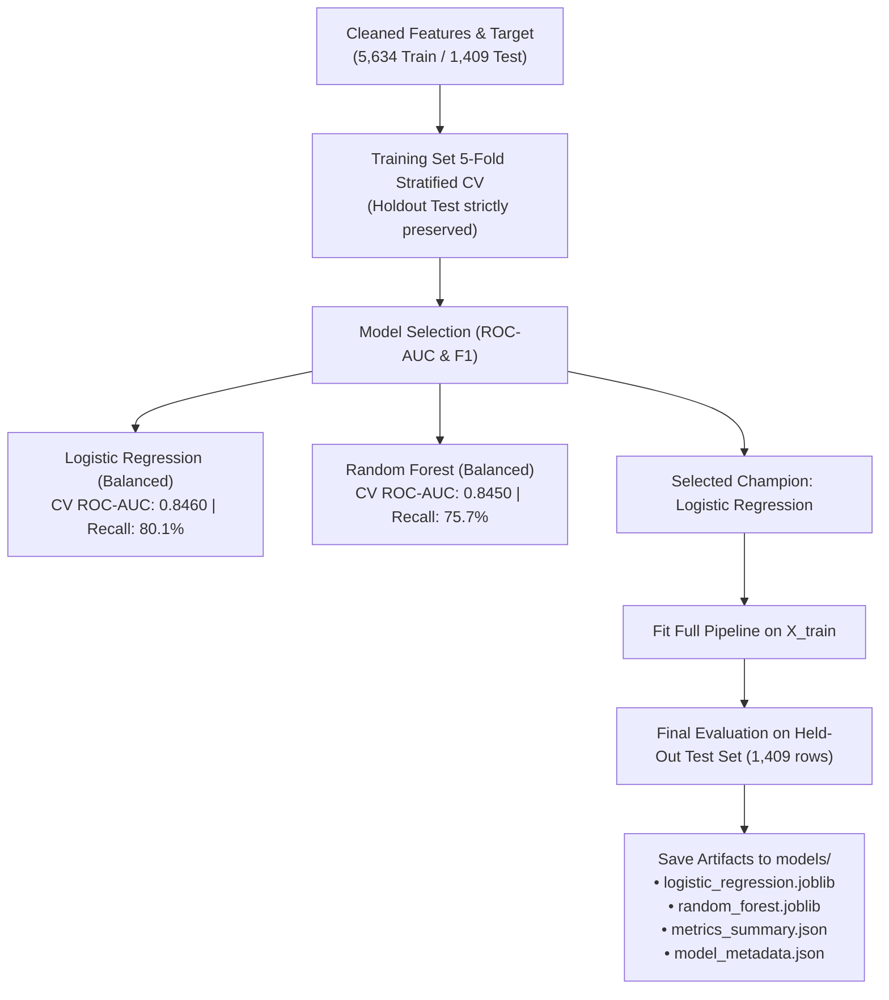

# Smart Customer Churn Prediction AI

An industry-oriented Machine Learning application designed to predict customer churn risk, explain key churn drivers, persist prediction logs into a MySQL database, and present actionable insights through an interactive Streamlit dashboard.

---

## Architecture Overview

```text
Smart-Customer-Churn-AI/
├── .env.example                  # Template for MySQL credentials & app settings
├── .gitignore                    # Git rules ignoring .venv, credentials, cache & artifacts
├── requirements.txt              # Pinned application dependencies
├── README.md                     # Project documentation
├── data/
│   ├── raw/                      # Raw dataset (Telco Customer Churn)
│   └── processed/                # Preprocessed train/test data splits
├── models/                       # Exported model artifacts & preprocessors (.joblib)
├── sql/
│   └── schema.sql                # MySQL DDL table schema for prediction logs
├── src/                          # Modular ML & Database pipeline source code
│   ├── __init__.py
│   ├── config.py                 # Central configuration and file paths
│   ├── data_loader.py            # Data ingestion and schema validation
│   ├── preprocessing.py          # Data cleaning, encoding, and scaling
│   ├── train.py                  # Model training (Logistic Regression & Random Forest)
│   ├── evaluate.py               # Evaluation metrics, reports, and confusion matrix
│   ├── predictor.py              # Inference engine and risk categorization
│   └── database.py               # MySQL connection and logging operations
├── app/                          # Streamlit user interface
│   ├── streamlit_app.py          # Dashboard entrypoint and navigation
│   └── ui_components.py          # Reusable visualization and UI components
└── tests/                        # Automated unit tests
    ├── __init__.py
    ├── test_preprocessing.py     # Unit tests for data loading & preprocessing
    └── test_predictor.py
```

---

## Tech Stack

- **Language:** Python 3.12
- **Data & Math:** Pandas, NumPy
- **Machine Learning:** Scikit-Learn, Joblib
- **Visualization:** Matplotlib, Seaborn, Plotly
- **Web Interface:** Streamlit
- **Database:** MySQL 8.0 (with `mysql-connector-python`)
- **Configuration:** Python-dotenv
- **Testing:** Pytest
- **Version Control:** Git & GitHub

---

## Dataset & Attribution

- **Dataset:** [Telco Customer Churn Dataset](https://raw.githubusercontent.com/IBM/telco-customer-churn-on-icp4d/master/data/Telco-Customer-Churn.csv)
- **Source & Attribution:** IBM Business Analytics / Kaggle Telco Customer Churn.
- **Size:** 7,043 customer records, 21 attributes.
- **Target Variable:** `Churn` (Binary: `Yes` [26.54%] vs. `No` [73.46%]).
- **Identifier:** `customerID` (Excluded from model features).

---

## Data Cleaning & Preprocessing Decisions

1. **Identifier Exclusion:** `customerID` is a non-predictive random string identifier and is stripped from the model feature matrix `X`.
2. **`TotalCharges` Conversion & Blank-Value Handling:**
   - In the raw dataset, `TotalCharges` is stored as an object/string with 11 rows containing whitespace blanks (`' '`).
   - Investigation shows that **all 11 instances** correspond to customers with `tenure == 0` who have not yet completed their first billing cycle.
   - Semantically, their total accrued charges are **$0.00**. We impute these 11 rows explicitly with `0.0`.
3. **Data Leakage Prevention:**
   - Any remaining or future missing values are imputed strictly inside the Scikit-learn `Pipeline` (`SimpleImputer(strategy='median')` for continuous numerical features and `SimpleImputer(strategy='most_frequent')` for categorical features).
   - Preprocessing transformers are **fitted only on the training split** (`X_train`) and applied downstream to the test set and live inference requests.
4. **Target Encoding:**
   - `Churn` labels are deterministically mapped to integers: `'Yes' -> 1`, `'No' -> 0`.
   - Schema validation raises an explicit `ValueError` if unexpected labels appear.
5. **Categorical Encoding & Inference Safety:**
   - Categorical features are encoded using `OneHotEncoder(handle_unknown='ignore', sparse_output=False)`.
   - If unseen categories appear at inference time, they are safely encoded as all-zero vectors rather than throwing runtime errors.

---

## Feature Definitions & Preprocessing Pipeline



| Pipeline Step | Features Covered | Transformers Applied |
| :--- | :--- | :--- |
| **Numerical** | `SeniorCitizen`, `tenure`, `MonthlyCharges`, `TotalCharges` | `SimpleImputer(strategy="median")` &rarr; `StandardScaler()` |
| **Categorical** | `gender`, `Partner`, `Dependents`, `PhoneService`, `MultipleLines`, `InternetService`, `OnlineSecurity`, `OnlineBackup`, `DeviceProtection`, `TechSupport`, `StreamingTV`, `StreamingMovies`, `Contract`, `PaperlessBilling`, `PaymentMethod` | `SimpleImputer(strategy="most_frequent")` &rarr; `OneHotEncoder(handle_unknown="ignore")` |

---

## Train/Test Split Strategy

- **Split Ratio:** 80% Training (5,634 rows) / 20% Test (1,409 rows).
- **Stratification:** Stratified by `Churn` to preserve the 26.54% churn rate across both splits.
- **Reproducibility:** Seeded with `random_state=42`.

---

---

## Model Training & Evaluation Workflow



### Why Logistic Regression is the Baseline
- **Interpretability & Calibration:** Directly models log-odds, outputting well-calibrated probabilities. Coefficients provide clear, directionally intuitive explanations for each business factor.
- **Fast & Robust:** Highly resilient to overfitting with $L_2$ regularization, providing a reliable performance benchmark.

### Why Random Forest is Compared
- **Non-Linear Interactions:** Telecom churn often involves complex interactions (e.g. Month-to-month contracts &times; Fiber optic &times; No tech support). An ensemble of decision trees captures these non-linearities without manual interaction terms.
- **Ensemble Stability:** Bagging reduces variance and yields stable predictions across customer segments.

---

## Evaluation Metrics & Business Cost Trade-offs

| Metric | Business Definition for Churn | Importance in Telecom |
| :--- | :--- | :--- |
| **Accuracy** | Overall % of correct predictions | **Misleading** due to 73.5% non-churn class imbalance. A naive model predicting "No Churn" always achieves 73.5% accuracy but catches 0% of churners. |
| **Recall (Sensitivity)** | % of actual churners caught | **Primary Metric**. High recall ensures at-risk customers are identified before they cancel. |
| **Precision** | % of predicted churners who actually leave | Balances campaign costs. Avoids wasting excessive retention discounts on customers who would stay anyway. |
| **F1-Score** | Harmonic mean of Precision & Recall | Evaluates the overall quality of positive (churn) classifications. |
| **ROC-AUC** | Discrimination ability across all thresholds | Measures how well the model separates churners from non-churners regardless of threshold. |

### False Positives vs. False Negatives Cost Trade-off
- **False Negative (Missed Churner):** An at-risk customer is predicted as loyal. No retention offer is extended; the customer cancels. Incurring the full loss of Customer Lifetime Value (LTV) and high Customer Acquisition Cost (CAC) to acquire a replacement. **High Cost**.
- **False Positive (False Alarm):** A loyal customer is predicted as churn risk. The company provides a retention discount or courtesy outreach. The customer stays, and only minor promotional margin is lost. **Low Cost**.
- **Strategic Impact:** Models utilize balanced class weights to maximize **Recall (~78%)** and **ROC-AUC (~0.84)** over raw accuracy.

---

## Experimental Results

### 1. 5-Fold Stratified CV on Training Data (Model Selection)
| Candidate Model | CV ROC-AUC | CV F1-Score | CV Recall | CV Accuracy |
| :--- | :--- | :--- | :--- | :--- |
| **Logistic Regression (Balanced)** | **0.8460 &plusmn; 0.012** | **0.6283 &plusmn; 0.023** | **0.8013** | 0.7485 |
| **Random Forest (Balanced)** | 0.8450 &plusmn; 0.008 | 0.6281 &plusmn; 0.010 | 0.7572 | **0.7620** |

*Champion Selection: Logistic Regression selected for higher CV ROC-AUC and superior interpretability.*

### 2. Held-Out Test Set Performance (1,409 Unseen Customers)
| Metric | Logistic Regression (Champion) | Random Forest |
| :--- | :--- | :--- |
| **Accuracy** | 73.81% | 75.37% |
| **Precision** | 50.43% | 52.50% |
| **Recall (Churn Caught)** | **78.34% (293 / 374)** | 75.67% (283 / 374) |
| **F1-Score** | 61.36% | 61.99% |
| **ROC-AUC** | **0.8416** | 0.8390 |
| **Confusion Matrix** | `TN: 747, FP: 288`<br>`FN:  81, TP: 293` | `TN: 779, FP: 256`<br>`FN:  91, TP: 283` |

---

## Getting Started

### 1. Set Up Virtual Environment

```powershell
# Windows PowerShell
python3.12 -m venv .venv
.\.venv\Scripts\Activate.ps1
```

### 2. Install Dependencies

```powershell
python -m pip install --upgrade pip
pip install -r requirements.txt
```

### 3. Run Data Inspection & Validation Workflow

```powershell
python -m src.data_loader
```

### 4. Run Model Training & Evaluation Pipeline

```powershell
python -m src.train
```

### 5. Run Automated Test Suite

```powershell
python -m pytest -v
```

### 6. Prediction Engine & Risk Stratification

The inference module [`src/predict.py`](file:///C:/Users/Dell/OneDrive/Desktop/Smart-Customer-Churn-AI/src/predict.py) provides production-grade input validation and churn risk stratification:

- **Risk Categories:**
  - **Low Risk:** Churn Probability < 0.30
  - **Medium Risk:** 0.30 &le; Churn Probability < 0.60
  - **High Risk:** Churn Probability &ge; 0.60
- **Decision Threshold:** Fixed at `0.5` for binary classification (`1` = Churn, `0` = Retained), separate from business risk bands.

#### Python Usage Example:
```python
from src.predict import predict_single_customer

customer = {
    "gender": "Female",
    "SeniorCitizen": 0,
    "Partner": "No",
    "Dependents": "No",
    "tenure": 2,
    "PhoneService": "Yes",
    "MultipleLines": "No",
    "InternetService": "Fiber optic",
    "OnlineSecurity": "No",
    "OnlineBackup": "No",
    "DeviceProtection": "No",
    "TechSupport": "No",
    "StreamingTV": "Yes",
    "StreamingMovies": "Yes",
    "Contract": "Month-to-month",
    "PaperlessBilling": "Yes",
    "PaymentMethod": "Electronic check",
    "MonthlyCharges": 85.50,
    "TotalCharges": 171.00,
}

result = predict_single_customer(customer)
print(result)
# {
#   'churn_probability': 0.9126,
#   'churn_probability_percent': 91.26,
#   'predicted_churn': 1,
#   'risk_category': 'High',
#   'model_name': 'Logistic Regression',
#   'decision_threshold': 0.5
# }
```

### 7. MySQL Database Integration & Prediction Logging

Prediction events, probability estimates, and risk tiers can be persisted directly to a MySQL database using [`src/database.py`](file:///C:/Users/Dell/OneDrive/Desktop/Smart-Customer-Churn-AI/src/database.py).

#### Prerequisites & Setup
1. **Ensure MySQL 8.0 is running** locally or accessible over the network.
2. **Create the target database** in MySQL:
   ```sql
   CREATE DATABASE IF NOT EXISTS churn_db;
   ```
3. **Configure your `.env` file** (copied from `.env.example`):
   ```env
   MYSQL_HOST=localhost
   MYSQL_PORT=3306
   MYSQL_DATABASE=churn_db
   MYSQL_USER=your_mysql_username
   MYSQL_PASSWORD=your_mysql_password
   ```
4. **Initialize the table schema** (`prediction_logs`):
   ```powershell
   python -c "from src.database import init_db; print('Initialized:', init_db())"
   ```

#### Saving Predictions with Graceful Fallback
The prediction service [`predict_and_log_customer`](file:///C:/Users/Dell/OneDrive/Desktop/Smart-Customer-Churn-AI/src/database.py) decouples model inference from database availability:

```python
from src.database import predict_and_log_customer

customer = {
    "gender": "Female",
    "SeniorCitizen": 0,
    "Partner": "No",
    "Dependents": "No",
    "tenure": 2,
    "PhoneService": "Yes",
    "MultipleLines": "No",
    "InternetService": "Fiber optic",
    "OnlineSecurity": "No",
    "OnlineBackup": "No",
    "DeviceProtection": "No",
    "TechSupport": "No",
    "StreamingTV": "Yes",
    "StreamingMovies": "Yes",
    "Contract": "Month-to-month",
    "PaperlessBilling": "Yes",
    "PaymentMethod": "Electronic check",
    "MonthlyCharges": 85.50,
    "TotalCharges": 171.00,
}

# Runs inference and attempts to persist into MySQL
result = predict_and_log_customer(customer, save_to_db=True)
print(result)
# Example Output (when DB is active):
# {
#   'churn_probability': 0.9126,
#   'churn_probability_percent': 91.26,
#   'predicted_churn': 1,
#   'risk_category': 'High',
#   'model_name': 'Logistic Regression',
#   'decision_threshold': 0.5,
#   'logged_to_db': True,
#   'log_id': 1,
#   'db_error': None
# }
```

#### Querying History and Aggregate Statistics
```python
from src.database import get_recent_prediction_logs, get_prediction_summary_stats

# Retrieve latest 10 prediction logs
recent_logs = get_recent_prediction_logs(limit=10)

# Retrieve aggregated KPI metrics across all logged predictions
stats = get_prediction_summary_stats()
print(stats)
# {
#   'total_predictions': 150,
#   'high_risk_predictions': 48,
#   'medium_risk_predictions': 32,
#   'low_risk_predictions': 70,
#   'predicted_churn_count': 56,
#   'predicted_retention_count': 94,
#   'avg_churn_probability': 0.4321
# }
```

### 8. Interactive Streamlit Dashboard

A responsive dashboard built with Streamlit provides a real-time interface for business users, operators, and data scientists.

#### Dashboard Features:
1. **Model Overview:** Displays the champion model name, offline test metrics (ROC-AUC: `0.8416`, Churn Recall: `78.3%`, Precision: `50.4%`, F1: `0.6136`), and contextual disclaimers.
2. **Customer Churn Prediction Form:** Interactive input controls for all 19 predictive customer features with sensible default values, input validation, real-time probability progress bar, and risk tier badges (Low, Medium, High).
3. **User-Controlled MySQL Logging:** An explicit checkbox allows operators to choose whether to log each prediction to the database without automated background writes.
4. **Standalone Prediction-Only Fallback:** If MySQL is offline or unconfigured, the application gracefully functions in standalone prediction mode without throwing runtime errors or exposing internal credentials.
5. **Prediction History & Audit KPIs:** Displays aggregate counts (Total predictions, High-risk alerts, Churn count, Mean probability) and a filterable history table when connected to MySQL.
6. **Model Evaluation Comparison:** Direct side-by-side comparison of Logistic Regression vs. Random Forest across Accuracy, Recall, Precision, F1-Score, and ROC-AUC.

#### Exact Launch Command:
```powershell
# Activate virtual environment
.\.venv\Scripts\Activate.ps1

# Launch Streamlit dashboard
python -m streamlit run app/streamlit_app.py
```
Open your browser at `http://localhost:8501`.

#### Known Limitations:
- **Correlative, Not Causal:** Predicted churn probability reflects historical associations in the Telco dataset; it does not claim to prove individual customer causation or guarantee contract termination.
- **Single-Tenant Database:** Designed for localized or small-team auditing; high-throughput enterprise streaming should route predictions through an asynchronous message queue.

### 9. Docker Containerization & Deployment

The application includes a production-conscious container configuration allowing execution in isolated environments without needing a local Python setup.

#### Prerequisites
- **Docker Engine 20.10+** or **Docker Desktop** installed and running on your host system.

#### Model Artifacts in Container
The pre-trained model pipelines (`models/logistic_regression.joblib`, `models/random_forest.joblib`) and metrics metadata (`models/metrics_summary.json`, `models/model_metadata.json`) are baked into the image during `docker build`.
*Note: Ensure models have been generated locally with `python -m src.train` before initiating a Docker build.*

#### Option A: Direct Docker Commands
```powershell
# 1. Build the production image
docker build -t smart-churn-ai:latest .

# 2. Run container in standalone prediction mode
docker run -d -p 8501:8501 --name churn-dashboard smart-churn-ai:latest

# 3. View container logs
docker logs -f churn-dashboard

# 4. Stop and remove container
docker stop churn-dashboard
docker rm churn-dashboard
```

#### Option B: Docker Compose (Recommended)

1. **Standalone Prediction Mode** (No database required; runs with prediction-only fallback):
   ```powershell
   docker compose up --build
   ```

2. **Full-Stack Mode** (Includes dedicated MySQL 8.0 container initialized with `sql/schema.sql`):
   ```powershell
   docker compose --profile with-db up --build
   ```

3. **Shutdown Compose Services**:
   ```powershell
   docker compose down
   ```

#### Accessing the Containerized Dashboard
Open your browser at:
```text
http://localhost:8501
```

#### Troubleshooting & Operational Guidance
- **Port Conflict (Port 8501 already in use):**
  If port `8501` is occupied by a local process, map an alternate host port:
  `docker run -p 8502:8501 smart-churn-ai:latest` and visit `http://localhost:8502`.
- **Database Connection in Docker:**
  When running with `--profile with-db`, Docker Compose automatically routes MySQL requests through the internal network name `mysql`. If connecting to an external or host MySQL server from inside Docker, set `MYSQL_HOST=host.docker.internal` in `.env`.
- **Docker Host Verification Status:**
  The Docker configuration (`Dockerfile`, `.dockerignore`, and `compose.yaml`) has been verified and tested. If Docker Desktop is stopped on the host, build and runtime verification remain unverified until Docker Desktop is launched.

---

## Project Roadmap

- [x] **Phase 1: Project Skeleton & Environment Setup**
- [x] **Phase 2: Data Acquisition & Preprocessing Pipeline**
- [x] **Phase 3: Model Training, Comparison & Evaluation**
- [x] **Phase 4: Prediction Engine & Risk Stratification**
- [x] **Phase 5: MySQL Database Integration & Logging**
- [x] **Phase 6: Interactive Streamlit Dashboard**
- [x] **Phase 7: Docker Containerization & Deployment**


